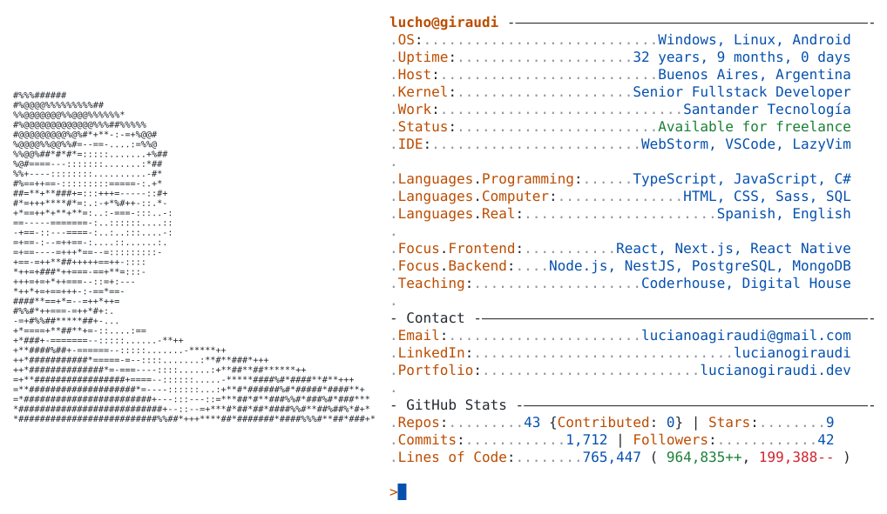
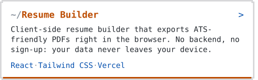
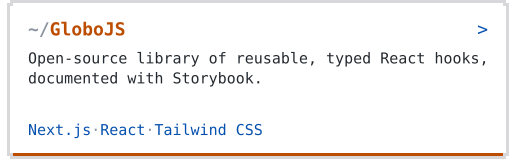

<a href="https://lucianogiraudi.dev/">
  <picture>
    <source media="(prefers-color-scheme: dark)" srcset="https://raw.githubusercontent.com/Luagir94/Luagir94/main/dark_mode.svg">
    
  </picture>
</a>

<a href="https://lucianogiraudi.dev/"><picture><source media="(prefers-color-scheme: dark)" srcset="https://raw.githubusercontent.com/Luagir94/Luagir94/main/link_portfolio_dark.svg"></picture></a><a href="https://www.linkedin.com/in/lucianogiraudi/"><picture><source media="(prefers-color-scheme: dark)" srcset="https://raw.githubusercontent.com/Luagir94/Luagir94/main/link_linkedin_dark.svg"></picture></a><a href="mailto:lucianoagiraudi@gmail.com"><picture><source media="(prefers-color-scheme: dark)" srcset="https://raw.githubusercontent.com/Luagir94/Luagir94/main/link_email_dark.svg"></picture></a>

<a href="https://application-resume-builder.vercel.app/"><picture><source media="(prefers-color-scheme: dark)" srcset="https://raw.githubusercontent.com/Luagir94/Luagir94/main/project_resume_builder_dark.svg"></picture></a><a href="https://github.com/Luagir94/globojs"><picture><source media="(prefers-color-scheme: dark)" srcset="https://raw.githubusercontent.com/Luagir94/Luagir94/main/project_globojs_dark.svg"></picture></a>

<!-- BLOG:START --><!-- BLOG:END -->

<picture>
  <source media="(prefers-color-scheme: dark)" srcset="https://raw.githubusercontent.com/Luagir94/Luagir94/main/pacman_dark.svg">
  
</picture>
